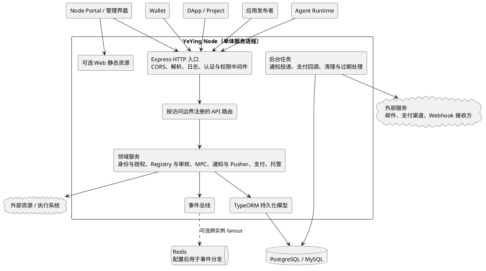
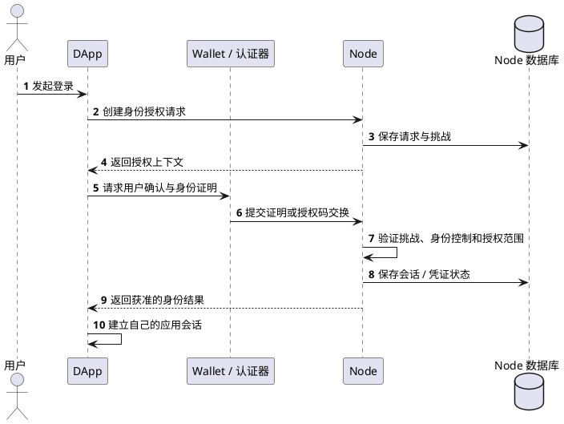
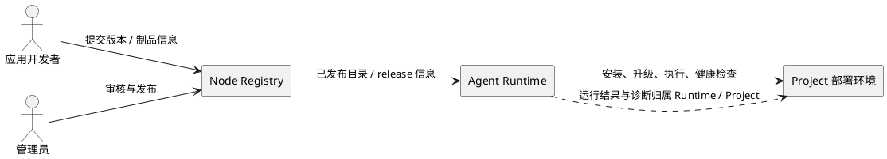

# 系统架构

本文说明 Node 在 YeYing 生态中的位置、当前系统组成、主要依赖和关键数据流。内容聚焦整体架构；身份安全、业务流程、数据表和 API 字段分别以文末链接的专题文档为准。本文描述当前实现，不把规划能力写作既有事实。

## 生态边界

Node 是 YeYing 生态的控制面，为社区应用和其他系统提供应用登记与发布目录、身份认证与授权、协调及平台服务。它保存平台元数据并验证请求，不接管调用方系统中的业务数据，也不负责客户端或 Project 的实际运行。

| 系统 | 主要职责 | 与 Node 的关系 |
| --- | --- | --- |
| Node | 应用 Registry、身份与授权、发布审核、MPC 协调、通知、Pusher、支付网关和托管密文控制面 | 提供可复用的平台 API 和管理入口 |
| Wallet | 用户身份控制、Passkey/钱包认证器交互、用户确认、本地密钥和 MPC 计算 | 调用 Node 完成身份授权、托管密文读写及 MPC 消息协调；用户私钥和 MPC key share 留在 Wallet 控制的客户端侧 |
| DApp / Project | 应用自身的用户体验、业务对象、订单、项目和业务权限 | 依赖 Node 的身份、目录或平台服务；业务数据和业务规则由应用自身维护 |
| Agent Runtime | 应用安装、升级、卸载、运行状态、健康检查和执行诊断 | 消费 Node 发布的目录/制品及授权能力；部署和执行不由 Node 完成 |
| Router、Warehouse 等平台服务 | 分别提供模型路由与计量、对象及文件数据面等服务 | 由各服务负责其数据与运行接口；Node 不充当这些服务的后端 |

社区产品关系与开发边界是生态职责的上位说明，见[社区产品关系与开发边界](https://github.com/yeying-community/books/blob/main/yeying/%E7%A4%BE%E5%8C%BA%E4%BA%A7%E5%93%81%E5%85%B3%E7%B3%BB%E4%B8%8E%E5%BC%80%E5%8F%91%E8%BE%B9%E7%95%8C.md)。

## Node 内部架构

Node 当前以一个 Express 服务进程提供 HTTP API 和可选的 Web 前端静态资源。`server.ts` 组装安全中间件、路由、关系数据库连接、事件总线和后台投递/清理任务；路由按公共、管理员和发布者等调用边界注册。领域服务承载主要业务规则，TypeORM 实体和迁移维护持久化模型。

Redis 是事件分发的辅助依赖，不是领域数据的权威存储。MPC 消息、通知、授权、应用发布和交易等业务状态由关系数据库及相应领域服务管理；各事件通道是否支持跨实例分发、游标续读或本地降级，见对应专题文档。生产数据库支持 PostgreSQL；代码也支持 MySQL 模式，具体初始化方式见[部署手册](../operations/生产环境部署手册.md)。

## 主要领域模块

| 模块 | Node 负责的能力 | 主要交互方 |
| --- | --- | --- |
| 身份与授权 | 钱包登录和邮箱身份流程、身份凭证、DApp 授权、UCAN 与访问策略 | Wallet、Node Portal、DApp / Project |
| 应用 Registry 与审核 | 应用登记、元数据与版本目录、发布审核、release artifact 索引及发布状态 | 应用开发者、管理员、DApp、Agent Runtime |
| MPC 协调器 | 会话与参与方元数据、签名请求、协议消息保存/查询和事件通知 | Wallet 客户端 |
| 通知与 Pusher | 通知收件箱及投递、应用事件通道和实时消息 fanout | 用户、应用服务、前端客户端 |
| 支付网关 | 商户配置、交易与退款状态、渠道通知和向商户服务投递支付事件 | DApp 后端、支付渠道 |
| 钱包托管控制面 | 对客户端加密托管密文的授权读写和状态管理 | Wallet 客户端 |
| Runtime / Project 元数据 | 应用发布与版本目录、Project 应用安装关系 | Project、Agent Runtime |

Node 的模块边界按业务责任划分，当前并非独立部署的微服务集合；它们共享 Node 进程和关系数据库。需要跨进程传播的实时事件通过对应事件总线处理。模块的详细模型和流程见[应用中心](../business/应用中心.md)、[MPC协调器](../business/MPC协调器.md)、[通知中心](../business/通知中心.md)、[Node-Pusher设计](../integrations/Node-Pusher设计.md)、[支付收银台](../business/支付收银台.md)和[钱包托管](../business/钱包托管.md)。

## 关键请求与数据流

### DApp 身份登录

Node 提供身份验证和授权结果，DApp 仍负责建立自己的应用会话。邮箱、Passkey、DID、VC、UCAN 和应用会话承担不同职责，安全规则见[Node登录授权](../identity/Node登录授权.md)、[DApp登录授权](../identity/DApp登录授权.md)、[通行密钥](../identity/通行密钥.md)及[身份凭证](../identity/身份凭证.md)。

### 应用发布与 Runtime 消费

Node 记录并发布应用目录及 release 状态；Runtime 消费发布信息并负责安装和执行。Node 的审核与发布不意味着 Node 在部署机上运行应用，也不意味着 Node 是 Project 的业务 API。协议契约和开发者步骤见[应用协议 v1](../protocols/YeYing-Application-Protocol-v1.md)、[AppStore 开发者手册](../protocols/YeYing-AppStore-Developer-Manual.md)及[应用中心](../business/应用中心.md)。

### 外部渠道与异步事件

支付渠道、邮件服务和商户 Webhook 通过外部接口与 Node 交互。Node 验证入站事件，持久化领域状态，并由后台任务执行可重试的出站投递；接收方需要按事件标识幂等处理。实时通知/Pusher 和 MPC 事件用于更新客户端视图或唤醒处理，业务状态仍应回到 Node API 和持久化数据核对。

## 安全与信任边界

- Node API 按路由和业务动作实施身份认证、角色/资源权限及请求签名或令牌能力校验；通过 HTTP 接入不代表调用方自动获权。
- 用户钱包私钥和 MPC key share 不由 Node 保存或参与本地签名计算。Node 的托管模块接收客户端加密后的材料；具体加密、恢复门禁和威胁边界见[钱包托管](../business/钱包托管.md)。
- Node 只对其负责的身份资料、应用目录、协调元数据、交易状态和投递记录作权威管理。DApp 订单、Project 任务、Runtime 实例、Router 计量和 Warehouse 对象内容仍由各自系统负责。
- Redis fanout、SSE/Webhook、支付渠道回调及客户端上报均不能替代持久化状态校验。事件是通知机制，业务状态应通过对应权威服务核实。
- 具体 HTTP 字段和错误语义以 [OpenAPI 3.1](../openapi/node.openapi.yaml) 为准；运行配置、密钥、TLS、代理和恢复操作以[生产环境部署手册](../operations/生产环境部署手册.md)为准。

## 延伸阅读

- 项目术语：[核心概念](./核心概念.md)
- 核心持久化模型：[数据结构](./数据结构.md)
- 身份认证与授权：[Node登录授权](../identity/Node登录授权.md)、[DApp登录授权](../identity/DApp登录授权.md)
- 应用发布与审核：[应用中心](../business/应用中心.md)、[应用协议 v1](../protocols/YeYing-Application-Protocol-v1.md)
- 协调、实时事件与消息投递：[MPC协调器](../business/MPC协调器.md)、[通知中心](../business/通知中心.md)、[Node-Pusher设计](../integrations/Node-Pusher设计.md)
- 支付和密钥托管：[支付收银台](../business/支付收银台.md)、[钱包托管](../business/钱包托管.md)
- API 与运行：[OpenAPI](../openapi/node.openapi.yaml)、[生产环境部署手册](../operations/生产环境部署手册.md)
