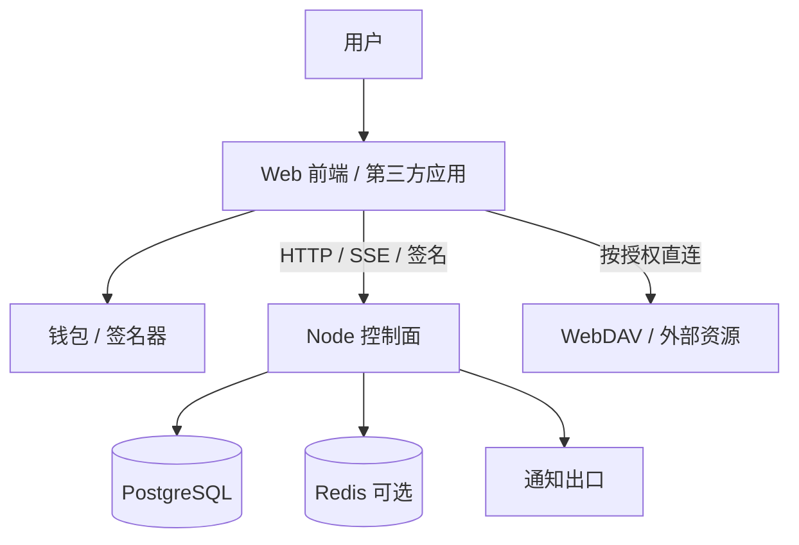
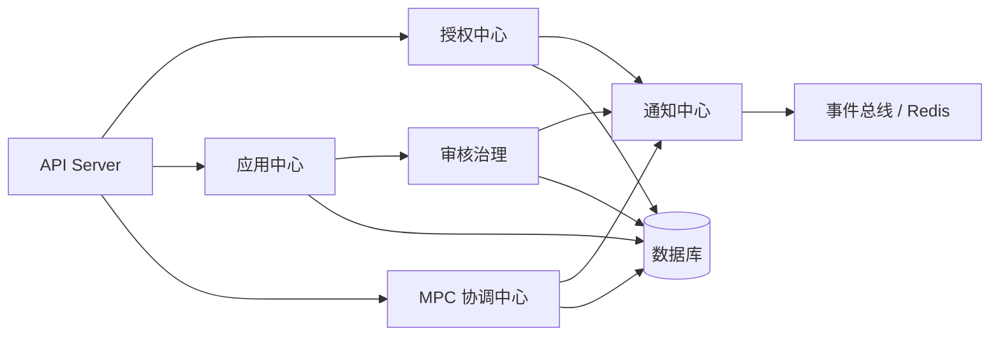

# 系统架构

本文描述 Node 当前的产品边界、系统关系、逻辑架构和已实现能力。设计目标或历史路线不作为当前事实；具体领域规则由对应专题文档维护。

## 生态定位

Node 在社区体系中是 Registry / Portal / Identity Provider，不是 Project 的业务后端，也不是 Agent Runtime。定位依据见 [社区产品关系与开发边界](https://github.com/yeying-community/books/blob/main/yeying/%E7%A4%BE%E5%8C%BA%E4%BA%A7%E5%93%81%E5%85%B3%E7%B3%BB%E4%B8%8E%E5%BC%80%E5%8F%91%E8%BE%B9%E7%95%8C.md)。

| 系统 | Node 当前职责边界 |
| --- | --- |
| Node | 应用登记、发布审核、release artifact、身份登录、UCAN/授权协作、通知、MPC 协调、托管密钥控制面 |
| Project | 项目、任务、文件协作、团队工作流、业务权限和业务 API |
| Agent Runtime | 智能体安装、升级、失败回滚、卸载、健康检查、实例运行状态和诊断 |
| Wallet | 用户签名、钱包私钥、用户侧授权确认 |
| Router | 模型访问、计量、额度和渠道 |
| Warehouse | 文件、对象、checksum、配额、复制和协议兼容数据面 |

Node 的核心职责由应用中心、授权中心、MPC 协调器和通知中心组成：

- **应用中心**管理应用登记、版本发布、审核、配置和目录检索。
- **授权中心**提供钱包登录、Node 会话、身份授权、UCAN 校验与签发。
- **MPC 协调器**管理多方会话和消息协调，不持有参与方私钥。
- **通知中心**将平台事件组织成用户通知，并负责 SSE、Webhook、Email 等投递。

这四个域形成统一入口、授权、协调和通知能力。Node 管理控制面和元数据，不取代 Project、Router、Warehouse、Wallet 或 Agent Runtime 的业务数据与执行职责。

## 逻辑架构

### 接入层

Web UI、第三方应用、Wallet 插件、移动端和服务端通过 HTTP API、回调、SSE 或各自的签名流程接入 Node。

### 平台服务层

- 应用中心：应用创建、编辑、发布、下架、版本和依赖元数据。
- 授权中心：SIWE/JWT、钱包身份授权码、UCAN 校验与签发、TOTP。
- MPC 协调中心：会话、参与方、消息交换、事件流和审计。
- 通知中心：站内收件箱、SSE、Webhook、Email 和投递追踪。
- 审核治理：应用发布审核、权限校验和管理员操作。

### 基础设施层

- Express API Server 承载 HTTP 接口；TypeORM 管理关系数据库和迁移。
- PostgreSQL 是生产环境的持久化状态库；Redis 可用于多实例事件 fanout 和流处理。
- WebDAV 等外部服务承载资源数据面；Node 保存授权及目录元数据。
- 前端静态资源由 Node 或部署层提供，生产流量由 Nginx 终止 TLS。

### 系统上下文

### 内部模块关系

## 身份与授权架构事实

- 钱包身份以 Wallet Identity DID 为主体。钱包或客户端负责生成和控制身份私钥；Node 验证控制证明并管理身份凭证和授权流程，不接收明文身份私钥。
- 用户可通过钱包 controller presentation 或注册在身份上的 Passkey 证明对既有身份的控制。邮箱 OTP 只证明邮箱控制权，不替代身份控制证明，也不会自动合并身份。
- Node 的 Identity Issuer 对已验证事实签发 VC。应用通过授权码与 PKCE 请求身份 scope，用户确认后应用只能取得授权范围内的凭证。
- Node 登录会话、身份 VC、UCAN 和短期资源授权会话承担不同职责：会话维持 Node 登录状态；VC 表达经过验证的身份事实；UCAN 或资源会话限制服务访问权限。
- 云端托管保存的是客户端加密的恢复材料，并受身份认证和授权门禁保护。Node 不解密或返回明文钱包密钥。

Node 登录、DApp 应用登录、认证器信任边界及 VC 生命周期分别见[Node登录授权](../identity/Node登录授权.md)、[DApp登录授权](../identity/DApp登录授权.md)、[认证器](../identity/认证器.md)和[身份凭证](../identity/身份凭证.md)。

## 已实现能力

### 1. 身份与会话

- SIWE challenge / verify / refresh / logout。
- JWT 站内登录态。
- 钱包身份以 Wallet Identity DID 为主体；Node 验证身份控制证明并签发身份凭证，不拥有身份控制器或钱包私钥。
- Passkey 用于认证已注册的钱包身份；应用通过授权码与 PKCE 请求 scope，获得授权范围内的身份资料。
- UCAN 或短期授权会话用于资源访问授权，与 Node 登录会话、身份 VC 分属不同职责。
- 用户状态默认化，历史 `UNKNOWN` 账号再次登录或活跃校验后升级为 `NORMAL`。
- 管理员用户列表、详情、角色和状态维护。

身份、凭证与授权的具体安全规则见[Node登录授权](../identity/Node登录授权.md)、[DApp登录授权](../identity/DApp登录授权.md)、[认证器](../identity/认证器.md)和[身份凭证](../identity/身份凭证.md)。

主要接口：

- `POST /api/v1/public/auth/challenge`
- `POST /api/v1/public/auth/verify`
- `POST /api/v1/public/auth/refresh`
- `POST /api/v1/public/auth/logout`
- `GET /api/v1/admin/users`
- `PATCH /api/v1/admin/users/:did/role`
- `PATCH /api/v1/admin/users/:did/status`

### 2. UCAN 与多模式授权

- 钱包 UCAN 校验模式。
- 中心化 UCAN issuer 模式。
- TOTP 绑定、授权请求、授权确认和授权码交换。
- 钱包身份 Passkey 注册、认证和钱包托管门禁协作。
- 应用 `appId`、`redirectUri`、`audience`、`capabilities` 的授权约束。

主要接口：

- `GET /api/v1/public/auth/central/issuer`
- `POST /api/v1/public/auth/central/session`
- `POST /api/v1/public/auth/central/issue`
- `POST /api/v1/public/auth/central/revoke`
- `POST /api/v1/public/identity/*`

### 3. 应用中心与审核治理

- 应用创建、更新、详情、搜索、配置、删除、上架和下架。
- 应用 owner / 管理员可见离线资源。
- 审核申请、撤销、详情、搜索、审批和驳回。
- 审核列表支持服务端过滤、分页和 comment 聚合态。
- 审核通过后联动应用发布状态和在线状态。

主要接口：

- `POST /api/v1/public/applications`
- `PATCH /api/v1/public/applications/:uid`
- `GET /api/v1/public/applications/:uid`
- `GET /api/v1/public/applications/:uid/releases`
- `GET /api/v1/public/applications/:uid/releases/:version`
- `POST /api/v1/public/applications/:uid/releases/:version/withdraw`
- `GET /api/v1/public/applications/:uid/config`
- `PUT /api/v1/public/applications/:uid/config`
- `POST /api/v1/public/applications/search`
- `POST /api/v1/public/applications/:uid/publish`
- `POST /api/v1/public/applications/:uid/unpublish`
- `POST /api/v1/public/audits`
- `POST /api/v1/public/audits/search`
- `GET /api/v1/public/audits/:uid`
- `DELETE /api/v1/public/audits/:uid`
- `POST /api/v1/admin/audits/:uid/approve`
- `POST /api/v1/admin/audits/:uid/reject`

### 4. Release Registry

- 发布者提交 release bundle。
- 服务端校验 schema、checksums、签名、镜像 digest 和 Compose 策略。
- 管理员 approve / reject / publish / withdraw release。
- Node 保留 release artifact 索引和发布目录，不执行部署机安装。

主要接口：

- `POST /api/v1/publisher/releases/submit`
- `POST /api/v1/admin/releases/:uid/approve`
- `POST /api/v1/admin/releases/:uid/reject`
- `POST /api/v1/admin/releases/:uid/publish`
- `POST /api/v1/admin/releases/:uid/withdraw`

### 5. MPC 协调器

- MPC session 创建、加入、消息发送、消息查询和 session 查询。
- SSE 推送。
- Redis Pub/Sub 跨实例事件分发。
- Redis Streams 事件保留、`Last-Event-ID` / `cursor` 追读和断线续传。
- 消息 `id` 由客户端提供，并参与签名与幂等。

主要接口：

- `POST /api/v1/public/mpc/sessions`
- `POST /api/v1/public/mpc/sessions/:sessionId/join`
- `POST /api/v1/public/mpc/sessions/:sessionId/messages`
- `GET /api/v1/public/mpc/sessions/:sessionId/messages`
- `GET /api/v1/public/mpc/sessions/:sessionId`
- `GET /api/v1/public/mpc/ws`

### 6. 通知中心一期

- 用户通知收件箱。
- 未读数、单条已读、全部已读。
- 通知 SSE。
- Webhook 配置、投递记录、重试和 replay。

主要接口：

- `GET /api/v1/public/notifications`
- `GET /api/v1/public/notifications/unread-count`
- `POST /api/v1/public/notifications/:uid/read`
- `POST /api/v1/public/notifications/read-all`
- `GET /api/v1/public/notifications/stream`
- `GET /api/v1/public/notifications/webhooks`
- `POST /api/v1/public/notifications/webhooks`
- `PATCH /api/v1/public/notifications/webhooks/:uid`
- `DELETE /api/v1/public/notifications/webhooks/:uid`
- `GET /api/v1/public/notifications/webhooks/:uid/deliveries`
- `POST /api/v1/public/notifications/webhooks/:uid/deliveries/:deliveryUid/retry`
- `POST /api/v1/public/notifications/webhooks/:uid/replay/:notificationUid`

### 7. 钱包托管控制面

- Passkey 门禁。
- 客户端加密密钥快照保存、查询和删除。
- Node 不保存钱包明文密钥，只保存客户端加密后的 `ciphertext`。

主要接口：

- `GET /api/v1/public/custody/status`
- `GET /api/v1/public/custody/secrets`
- `GET /api/v1/public/custody/secrets/:walletId`
- `POST /api/v1/public/custody/secrets`
- `DELETE /api/v1/public/custody/secrets/:walletId`

### 8. 运行与运维基线

- Express API Server。
- TypeORM + PostgreSQL migration。
- MySQL 兼容模式。
- Redis 可选。
- OpenAPI 3.1 生成和一致性检查。
- 前端静态资源托管。
- 加密配置启动、密钥初始化和运行配置文档。

## Node 不负责的能力

- Project 安装、升级、失败回滚和卸载。
- Runtime Agent 任务领取、心跳、释放和上报。
- 部署机 Docker / Compose 执行。
- Agent 实例状态、日志、健康检查和诊断。
- Project 任务、文件、评论和业务权限主数据。
- Warehouse 文件内容和对象数据面。
- Router 模型路由、额度和计量。

这些能力应分别由 Agent Runtime、Project、Warehouse 和 Router 承担。Node 可以提供发布目录、授权结果和 release artifact，但不接管运行时状态。
