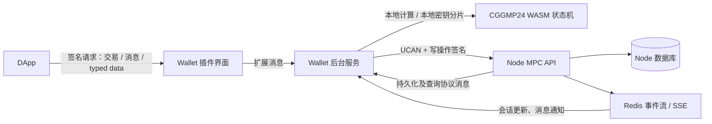
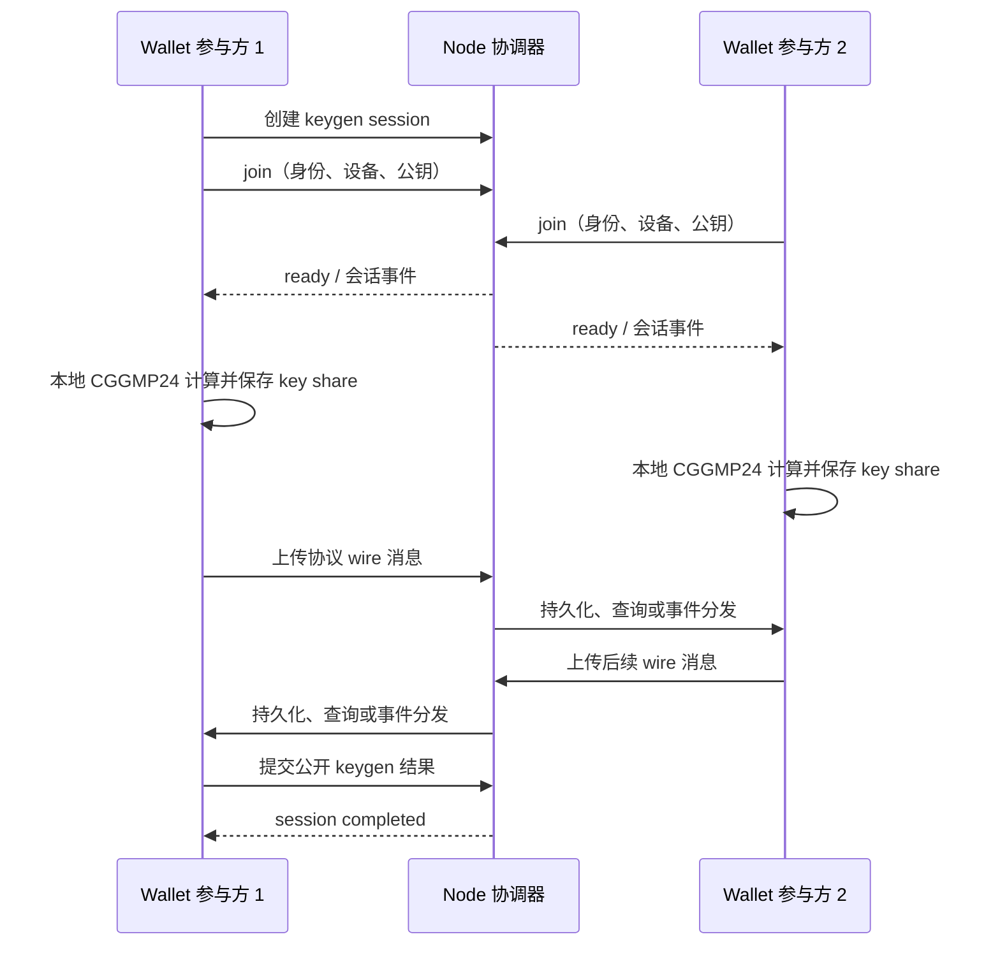

# MPC协调器

本文以 Node 与 YeYing Wallet 浏览器插件当前代码为依据，说明 MPC 钱包的业务对象、组件边界、密钥生成与签名过程，以及 Node 能看到和保存的数据。Node API 字段以 [OpenAPI](../openapi/node.openapi.yaml) 为准；MPC 属于钱包本地计算与 Node 协调的组合能力，不代表 Node 托管私钥。

## 业务目标与参与方

MPC 钱包把一个签名密钥拆分为多个参与方各自持有的密钥分片。达到门限的参与方共同运行协议，生成公钥或签名。常见的 `2-of-3` 表示三个参与方中任意两个参与即可完成协议；门限、参与方顺序和曲线在会话创建时确定。

参与方在当前实现中由钱包地址标识，加入会话时还登记设备 ID、身份标识、E2E 公钥和签名公钥。钱包插件把本地用户交互、设备密钥和 MPC 引擎组合起来；Node 提供会话目录、参与者登记、消息持久化和分发、签名请求记录与事件流。DApp 只向 Wallet 请求签名，不直接访问 Node MPC 数据库，也不参与密钥分片计算。

| 对象 | 业务含义 | 当前实现中的职责 |
| --- | --- | --- |
| Wallet | 一组 MPC 钱包的公开信息及版本 | 记录钱包 ID、名称、曲线、地址、公钥、key version、share version 等；私钥分片保存在各参与方钱包本地 |
| Session | 一次 keygen、sign 或 refresh 协议的协调上下文 | 记录类型、门限、参与方列表、状态、轮次、过期时间及钱包版本 |
| Participant | 会话中一个钱包地址对应的协议参与方 | 绑定 participant ID、device ID、身份和设备公钥；参与方在协议中的索引由会话参与方顺序决定 |
| Message | MPC 协议参与方之间传递的协议数据 | Node 按会话保存消息、序号、发送者、接收者和 envelope，并支持查询、续传及事件推送 |
| Sign request | 对某个钱包和签名会话的一次业务签名意图 | 记录 payload type/hash、payload、chain ID、状态及签名结果；与 session 状态分开管理 |
| Key share | 某参与方持有的本地密钥分片 | 由 Wallet 本地 CGGMP24 引擎产生并在 Wallet 本地加密保存，不上传给 Node |

## 组件与架构边界

**DApp** 通过 Wallet provider 发起交易、消息或 typed data 签名请求。Wallet 展示来源和待签内容，并通过用户确认流程决定是否进入签名；DApp 不接触本地 key share。

**Wallet 插件** 的界面层负责请求展示和用户交互，后台 `MpcService` 负责会话流程、设备密钥、协调器 API、消息收发和本地状态恢复。`MpcCoordinatorClient` 把调用发送到 Node，并提供 UCAN；写操作另外附带绑定动作与请求内容的 action signature。后台调用 CGGMP24 WASM 状态机执行 keygen、aux-info 和 sign 计算。MPC key share 在本地加密存储，协议状态也按 Wallet 的本地存储能力管理。

**Node MPC 服务** 验证 UCAN `mpc/coordinate` 能力、登录用户状态和写权限；对写操作校验 action signature，并验证参与者与请求身份关系。Node 创建和更新会话、登记参与方、保存消息和签名请求、产生审计记录，并通过事件流通知客户端。Node 不运行 CGGMP24 私钥分片运算，也不接收或保存 key share。

**设备与参与方的关系**：参与方是会话中的钱包身份，设备是该参与方本次接入的具体客户端。一个钱包身份可从不同设备运行客户端；设备密钥用于设备登记、消息签名或 E2E 路径。当前协议中的 `sender_index`、`recipient_index` 对应 `session.participants` 数组位置，客户端须使用相同参与方顺序解释索引。

## 密钥生成流程

1. 发起方在 Wallet 选择钱包名称、参与方、门限和曲线。插件创建 `keygen` session，并把会话信息提交 Node；当前插件随后登记本地参与方并加入会话。
2. 受邀参与方在 Wallet 接受邀请后加入。Node 校验参与方是否在允许列表、身份地址是否匹配，并登记设备 ID 及公钥。当加入人数达到门限，会话进入 `ready`。
3. 每个 Wallet 后台按参与方顺序确定本地索引，在本地启动 CGGMP24 WASM keygen 状态机。状态机产生协议消息后，客户端将消息交给 Node 保存并分发；各参与方拉取或接收消息，在本地推进各自的状态机。
4. 完成后，各 Wallet 在本地保存自己生成的 key share。客户端向 Node 报告公开的 keygen 结果，例如地址、公钥、曲线和 key/share version；Node 将会话标记为 `completed` 并保存公开结果。

Node 的会话状态主要为 `created`、`invited`、`ready`、`rounds`、`completed`、`cancelled`、`expired`。参与者达到门限后进入 `ready`，首条协议消息到达后进入 `rounds`。当前只有 `keygen` 会话可由参与方列表中的发起者在 `created` 或 `invited` 状态取消；过期会话不能继续加入、发送消息或提交结果。`sign` 和 `refresh` 类型可以创建会话并传输协议消息，但当前 Node 没有通用的 keygen 完成接口供它们复用。

## 签名流程

1. DApp 将待签交易、消息或 typed data 交给 Wallet。Wallet 解析请求并等待用户确认。
2. Wallet 准备 MPC 钱包和本地 key share，构造实际签名 payload。当前签名类型包括 `transaction`、`message` 和 `typed_data`。
3. 客户端通过 Node 建立或选择签名 session，并创建独立的 sign request。Node 保存 `payloadType`、`payloadHash`、可选 `payload`、`chainId` 与请求状态。
4. 参与方在本地启动 CGGMP24 sign 状态机，通过 Node 交换协议 wire 消息；每个参与方都只使用自己的本地 key share 计算。
5. Wallet 取得完成的签名后，将签名结果回报 Node 更新 sign request，再把适配后的结果交回 DApp。交易签名会组装成链要求的已签交易；消息和 typed data 返回签名值。

签名请求是业务层的待签记录，协议消息是计算层的多轮交互记录。完成一个 sign request 不应与 `session.status=completed` 混为一谈；Node 的会话完成接口当前是 keygen 专用路径。

## 消息内容与隐私边界

Node 支持两类消息封装，安全属性不能混为一谈：

- 传统 envelope 消息由 Wallet 的 E2E 加密路径生成。只有在客户端确实加密了载荷、且密钥管理正确时，才能据此主张相应的端到端保密性。
- 当前 CGGMP24 wire 消息带有 `engine`、`protocol`、`sender_index`、`audience`、`sequence` 和 `payload` 等字段。Node 校验格式、参与者索引和路由范围，并将 wire envelope 原样持久化。该 API 当前没有对 `payload` 做 E2E 加密；Node 及可读取 Node 数据库的运维方可能接触这些协议载荷。

因此，“Node 不执行 MPC 计算、不持有 key share”不等于“Node 看不到所有 MPC 消息明文”。加入时登记的 E2E 公钥也不能单独证明 wire payload 已被加密。Node 还会保存钱包公开元数据、参与者和设备标识、消息时序/路由信息、审计信息，以及签名请求里的 payload 和签名结果。生产环境应按这些数据可能包含敏感签名意图及协议材料来控制访问、日志、备份和保留周期。

## 鉴权、事件与接口

Node MPC API 使用 Bearer UCAN，并要求 `mpc/coordinate` 能力。写操作还校验活跃用户、业务写权限和 action signature。action signature 绑定业务动作和请求内容；消息 ID、wire sequence、签名请求 ID 分别承担幂等、排序和业务关联作用。

客户端可以通过消息查询接口轮询，也可以订阅 `/api/v1/public/mpc/ws`。该路由当前实际提供 SSE，而不是 WebSocket；支持 Redis 多实例事件分发和配置 Streams 时的游标续读。事件用于低延迟通知，消息查询与序号游标才是恢复处理进度的来源。

| 动作 | 接口 |
| --- | --- |
| 查询邀请 | `GET /api/v1/public/mpc/invites` |
| 创建会话 | `POST /api/v1/public/mpc/sessions` |
| 加入会话 | `POST /api/v1/public/mpc/sessions/:sessionId/join` |
| 取消 keygen 会话 | `POST /api/v1/public/mpc/sessions/:sessionId/cancel` |
| 查询会话 | `GET /api/v1/public/mpc/sessions/:sessionId` |
| 发送协议消息 | `POST /api/v1/public/mpc/sessions/:sessionId/messages` |
| 拉取协议消息 | `GET /api/v1/public/mpc/sessions/:sessionId/messages` |
| 提交 keygen 公开结果 | `POST /api/v1/public/mpc/sessions/:sessionId/complete` |
| 创建/查询签名请求 | `POST` / `GET /api/v1/public/mpc/sign-requests` |
| 完成签名请求 | `POST /api/v1/public/mpc/sign-requests/:requestId/complete` |
| 订阅 SSE 事件 | `GET /api/v1/public/mpc/ws?sessionId=...` |

具体请求字段和响应模型见 [MPC OpenAPI 定义](../openapi/node.openapi.yaml)；通用数据实体见[数据结构](../architecture/数据结构.md)，Node 与 Wallet 的整体组件边界见[系统架构](../architecture/系统架构.md)。
