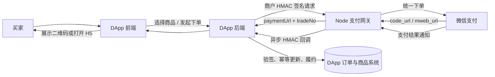
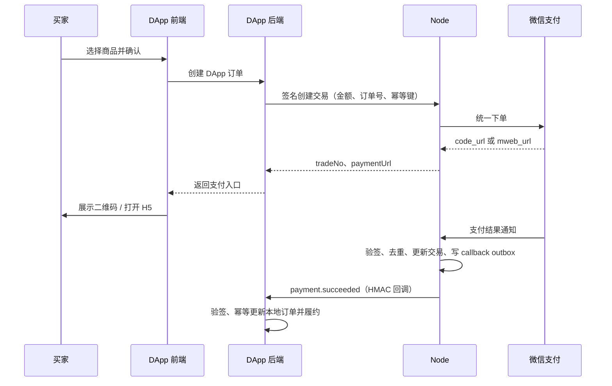

# 支付收银台

本文描述 Node 当前已实现的支付网关业务和 DApp 接入边界。Node 提供商户、支付交易、微信支付下单与查单、关单、退款、渠道通知验签和商户回调；Node 不保存商品目录或业务订单，不负责发货、记账，也不提供商户提现/打款接口。API 字段以 [OpenAPI](../openapi/node.openapi.yaml) 为准。

## 业务模型与职责

支付链路由四类主体组成：

| 主体 | 业务职责 |
| --- | --- |
| 买家 | 在 DApp 选择商品并确认支付；使用微信完成付款 |
| DApp 前端 | 展示商品和支付入口，打开二维码或 H5 收银台；不保存商户密钥、不根据浏览器跳转结果确认已付款 |
| DApp 后端（例如 Router） | 拥有商品和业务订单的权威数据；核定金额、调用 Node 创建交易、验签处理支付回调、履约发货，并管理退款策略 |
| Node 支付网关 | 管理商户凭据，向支付渠道下单/查单/关单/退款，验证渠道通知，保存支付状态并异步投递已签名商户回调 |
| 微信支付 | 执行实际收款并维护渠道侧订单；按商户号及微信商户结算设置向商户结算 |

Node 的 `merchant` 是 DApp 后端调用网关的凭据和回调配置，不是商品或订单。Node 的 `transaction` 表示一次渠道收款尝试，`externalOrderId` 关联 DApp 自己的订单；`tradeNo` 是 Node 生成的支付交易号。`refund` 表示这笔渠道交易的退款记录。订单金额、商品、买家、库存、优惠和权益仍由 DApp 后端维护。

| 数据对象 | 归属 | 当前记录的核心内容 |
| --- | --- | --- |
| Merchant | Node | 所有者、名称、回调 URL、加密保存的商户 API secret、启停状态 |
| DApp order | DApp 后端 | 商品明细、买家、价格、库存和业务履约状态；Node 不创建此实体 |
| Payment transaction | Node | 商户、外部订单号、金额（最小货币单位）、币种、渠道、渠道订单号、支付 URL、幂等键、状态和支付时间 |
| Provider event | Node | 渠道事件 ID、事件类型、交易号；用于防止重复消费 |
| Callback delivery | Node | 业务事件 payload、目标 URL、投递状态、尝试次数和下次重试时间 |
| Refund | Node | 原交易、退款金额、原因、退款幂等键、渠道退款号和退款状态 |

## 当前能力与收款、提现边界

当前默认渠道实现是微信支付 V2，支持 Native 扫码和 H5 下单、查单、关单、退款和退款查询。生产 API 主机被限制为 `api.mch.weixin.qq.com`；测试替代主机必须显式列入配置。微信 V3 未实现，接入其他渠道也需要单独增加 provider。

用户支付成功后，资金按微信商户号及微信侧结算配置结算到商户的渠道账户/结算账户。Node 只记录交易状态并通知 DApp 后端，它没有资金余额账本，也没有提现申请、商户打款、银行卡绑定、分账或结算查询 API。因此，商户收款后的提现/结算在当前版本由商户按微信支付的商户平台和结算规则处理；DApp 若要向自己的卖家或用户付款，需要另行集成合规的出款服务并维护独立的资金与对账模型。

退款是原渠道交易的资金退回，不等于提现。当前退款 API 要求商户后端发起，并通过微信退款接口处理；部分退款累计不得超过原支付金额。

## DApp 集成架构



### 1. 开通商户并保管凭据

商户所有者登录 Node 后，在 `/payments` 创建 merchant 并配置 HTTPS 回调地址。创建时返回的 `secret` 只展示一次；Node 使用 secrets vault 中的 `NODE_KEY_DERIVATION_SECRET` 加密保存。生产环境由 DApp 后端安全保存 `merchantId` 和 `secret`，不得将 secret 放入前端代码、浏览器存储、移动端包或支付 URL。

`/payments` 的测试表单可以直接向 Node 发起联调交易，因此输入 secret 仅用于开发者测试。正式 DApp 前端必须只调用自己的 DApp 后端。每个 merchant 目前对应一个固定回调 URL；创建 merchant 时 Node 校验 URL 和 DNS 目标，生产要求 HTTPS，并在每次投递时重新解析目标，阻止指向私网/保留地址的 SSRF 目标。

### 2. DApp 后端创建自己的订单，再请求 Node 下单

用户选择商品后，DApp 后端从自己的商品和价格数据计算总额，创建本地待支付订单。不能信任前端传来的价格，也不能因为收到浏览器 return URL 或前端轮询报告就发货。后端以商户签名请求调用 Node：

```http
POST /api/v1/public/payment/gateway/transactions
X-Payment-Merchant: <merchantId>
X-Payment-Timestamp: <Unix 毫秒或秒>
X-Payment-Nonce: <唯一随机值>
X-Payment-Signature: sha256=<hex>
Content-Type: application/json
```

```json
{
  "externalOrderId": "order-2026-000123",
  "amountMinor": "12800",
  "currency": "CNY",
  "description": "年度会员",
  "clientType": "native",
  "idempotencyKey": "order-2026-000123-payment-1"
}
```

金额必须是十进制整数字符串，单位为分；当前仅接受 CNY。Node 生成 `tradeNo`，保存交易并调用渠道下单，返回 `paymentUrl` 和 `expiresAt`。`native` 的 `paymentUrl` 是微信 Native `code_url`，DApp 页面应将其渲染为二维码；`h5` 需要 `returnUrl`，返回微信 H5 `mweb_url`，前端在适当设备/浏览器中打开。H5 return URL 只用于买家返回体验，不是支付凭据。

同一 merchant 下重复使用 `idempotencyKey` 且业务字段相同时返回原交易；同一 key 配不同字段会冲突。DApp 后端应以本地订单作为幂等主键，避免用户重复点击产生多笔收款。

商户签名采用：

```text
HMAC-SHA256(secret,
  merchantId + "." + timestamp + "." + nonce + "." + canonicalJson(body))
```

对象键递归排序生成 `canonicalJson`。Node 检查签名、请求时间窗并消费 nonce，阻止篡改和重放。签名由服务端持有 secret 生成；不能把此机制理解为浏览器可以安全地持有 merchant secret。

### 3. 展示支付入口并查询状态

DApp 后端把 `tradeNo`、`paymentUrl` 和适合前端展示的订单信息返回给前端。前端显示二维码或打开 H5 支付，然后可展示“等待支付”状态。前端可向 DApp 后端查询订单状态；后端再使用签名的 Node 查单接口核对渠道状态。用户关闭页面、返回失败页或轮询超时都不能视为支付失败，最终状态应由渠道通知或服务端查单确认。

### 4. 验证支付回调并履约

微信调用 `POST /api/v1/public/payment/gateway/webhooks/wechat`。Node 验证微信 V2 通知签名、商户、交易和金额，并按 `provider + eventId` 去重；有效支付将 Node 交易置为 `paid`。同一数据库事务中，Node 写入 `payment.succeeded` callback outbox 记录，后台 worker 再投递到 merchant 配置的 DApp HTTPS callback URL。

支付成功回调 body 示例：

```json
{
  "eventId": "payment.succeeded:PAY...",
  "type": "payment.succeeded",
  "merchantId": "pm_...",
  "tradeNo": "PAY...",
  "externalOrderId": "order-2026-000123",
  "amountMinor": "12800",
  "currency": "CNY",
  "provider": "wechat",
  "providerOrderId": "微信渠道订单号",
  "paidAt": "2026-11-08T00:00:00.000Z"
}
```

Node 使用 merchant secret 对回调签名，并发送 `X-Yeying-Payment-Event`、`X-Yeying-Payment-Timestamp`、`X-Yeying-Payment-Nonce`、`X-Yeying-Payment-Signature`。DApp 后端应先验证 HMAC 和时间窗，再以 `eventId` 或 `tradeNo` 幂等处理，确认 `externalOrderId`、金额、币种及订单状态均匹配后，在自己的事务中标记已支付并履约。重复回调不得重复发货。回调 outbox 使用有限次数与指数退避；DApp 应返回 2xx 表示成功接收，并提供后台告警/对账处理最终失败的投递。

Node 当前建立商户回调的事件包括 `payment.succeeded`，以及退款查询确认成功时的 `refund.succeeded`。商户回调不是 DApp 订单数据库事务的一部分；若收款已成功但回调暂时失败，应以服务端查单和后续回调恢复，而不是取消已完成的支付。

### 5. 退款

DApp 后端先根据自身订单和履约规则决定是否退款，再通过 `POST /api/v1/public/payment/gateway/refunds` 提交 `tradeNo`、`amountMinor`、`reason` 和 `idempotencyKey`。Node 向渠道申请退款并记录 `pending`/`processing` 等状态；DApp 使用退款查询接口核对结果。退款成功后，Node 更新交易为 `partially_refunded` 或 `refunded`，并排入 `refund.succeeded` 回调。不要把退款申请已受理当作退款已到账。

## 状态和数据流

支付交易主要状态：

```text
creating -> pending -> paid
creating -> failed
pending  -> failed | cancelled
paid     -> refund_pending -> partially_refunded | refunded
partially_refunded -> refund_pending -> partially_refunded | refunded
```

退款记录状态为 `pending`、`processing`、`succeeded` 或 `failed`。退款的最终状态通过渠道查询刷新；当前实现的支付渠道通知路由只处理支付交易通知。关闭订单仅适用于 `creating` 或 `pending` 交易。所有支付状态都应按服务端的 Node/渠道结果更新，不能由前端直接改写。



## API 与访问控制

商户管理使用 Node Bearer 身份和业务写权限；商户创建时只返回一次明文 secret。交易、查询、关单、退款和退款查询使用 merchant HMAC 请求头。微信通知由渠道调用，不使用商户 HMAC 请求头，而由 provider 校验微信 V2 XML 签名。

| 动作 | 接口 |
| --- | --- |
| 创建、列表、停用商户 | `POST` / `GET` / `DELETE /api/v1/public/payment/gateway/merchants` |
| 创建交易 | `POST /api/v1/public/payment/gateway/transactions` |
| 查单、关单 | `POST /api/v1/public/payment/gateway/transactions/query`、`POST /api/v1/public/payment/gateway/transactions/cancel` |
| 申请退款、查退款 | `POST /api/v1/public/payment/gateway/refunds`、`POST /api/v1/public/payment/gateway/refunds/query` |
| 微信支付通知 | `POST /api/v1/public/payment/gateway/webhooks/wechat` |

当前还存在用于测试的 mock provider webhook 路由；生产支付凭据须通过 Node secrets vault 注入，不能写入普通配置文件或仓库。

## 部署、密钥和迁移

`config.js.template` 中只放非敏感支付参数，微信和加密密钥通过 secrets vault 提供：

- `PAYMENT_WECHAT_APP_ID`
- `PAYMENT_WECHAT_MCH_ID`
- `PAYMENT_WECHAT_API_V2_KEY`
- `PAYMENT_WECHAT_CERT_PEM`
- `PAYMENT_WECHAT_KEY_PEM`
- `NODE_KEY_DERIVATION_SECRET`

数据库迁移 `20261015100000-add-payments` 创建商户、交易、退款、请求 nonce、provider event 和 callback delivery 数据表。回滚代码不会撤销已经发生的渠道收款或退款；升级前应备份数据库并确认迁移完成。

从旧系统切换时，Node 与 PHP 的支付记录和 webhook 不共享。只把新订单路由到 Node，历史订单继续由其原有系统处理；不能让 PHP 与 Node 同时处理同一笔渠道通知。生产切换前使用独立测试商户完成真实环境小额下单、通知、查单、退款和回调验收，并准备对账及回滚按订单归属的操作步骤。

## 当前不包含的功能

- Node 不维护 DApp 商品、库存、优惠、订单履约、卖家分账或财务账本。
- Node 不提供余额查询、提现申请、银行卡管理、商户主动出款或平台分账 API。
- 当前只实现微信支付 V2 provider；微信 V3、其他收款渠道及出款渠道须单独设计和实现。
- `/payments` 是 Node 商户管理与开发联调页面，不是可嵌入 DApp 的托管商品收银台，也不应让生产浏览器保存商户 secret。
