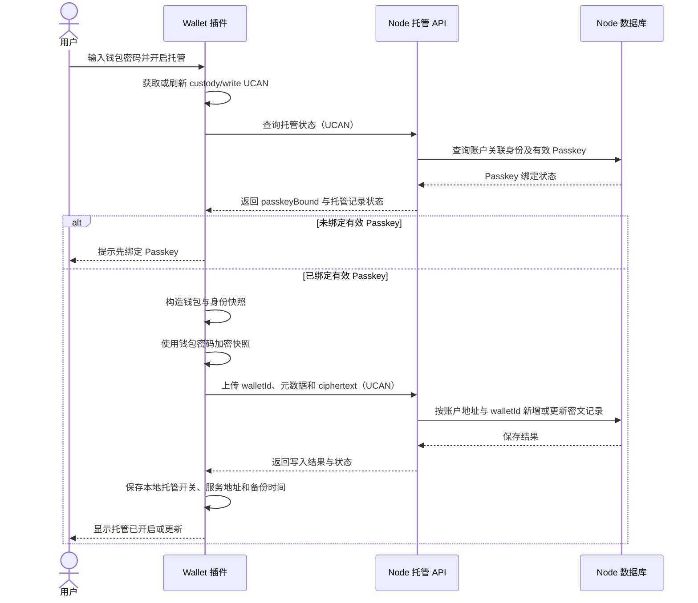
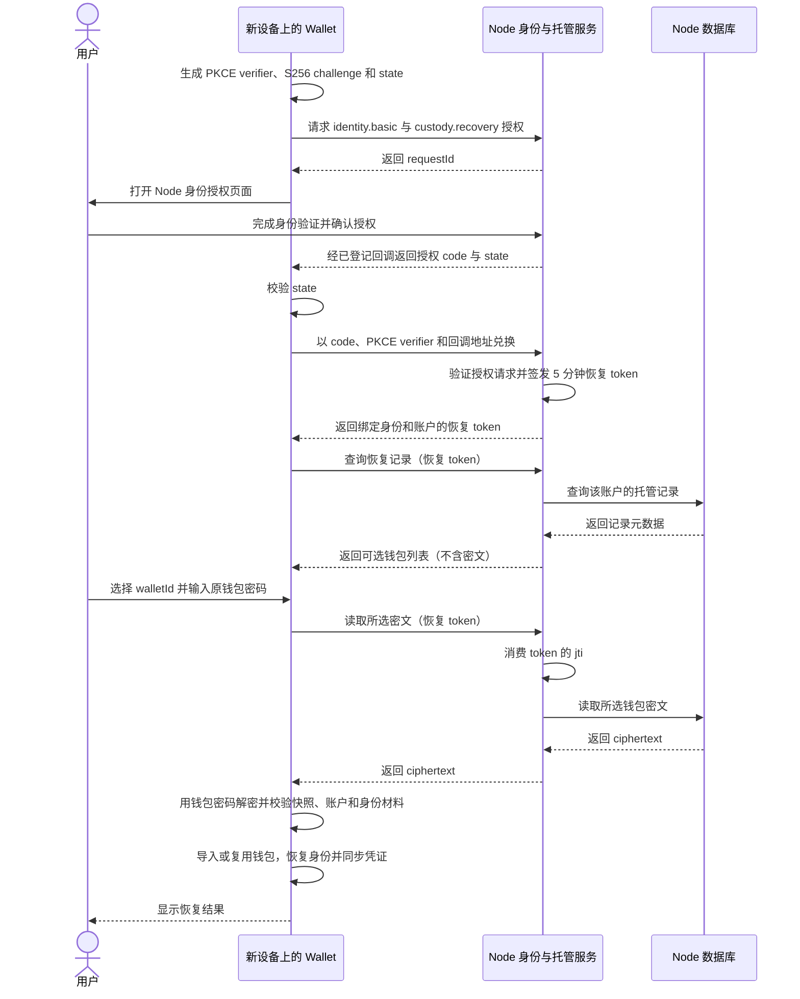
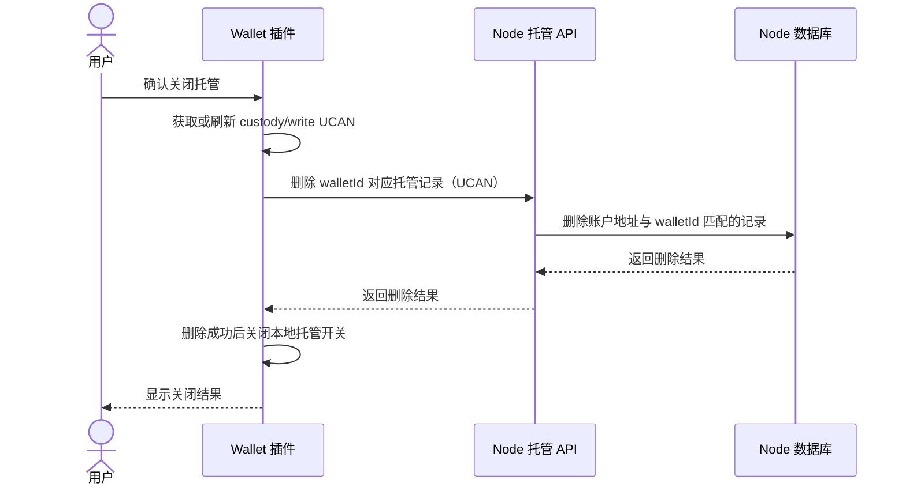

# 钱包托管

本文面向钱包用户、Wallet 插件和 Node 运维人员，说明 YeYing Cloud 钱包托管的业务模型、数据流、恢复条件和安全边界。本文描述当前实现；接口字段以 [OpenAPI](../openapi/node.openapi.yaml) 为准，Node 的术语以[核心概念](../architecture/核心概念.md)为准。

## 业务定义与边界

钱包托管是用户主动选择的一项加密备份服务：Wallet 在本地把恢复钱包所需的密钥材料和身份资料打包，使用原钱包密码加密，再把密文上传到 Node。Node 保存密文及用于展示、定位记录的元数据；Node 不接收钱包密码，不解密密文，也不持有明文私钥。

托管解决的是设备丢失或更换后的加密备份读取问题。它不代替用户保管密码，也不代表 Node 能代用户签署交易或控制钱包。恢复需要两项相互独立的条件：

1. 通过绑定到身份的钱包账户和 Passkey，完成 Node 的身份恢复授权，取得短期 `custody.recovery` token。
2. 在 Wallet 本地输入创建该托管密文时使用的钱包密码，解密并校验密钥材料。

Passkey 授权允许 Wallet 读取密文，但不能解密密文；钱包密码可以解密密文，但单独不能从 Node 取得密文。邮箱验证码、普通 Node/Router 登录会话、DApp 会话或单独的 Passkey 登录都不能替代托管恢复授权。

钱包托管与下列能力相互独立：

| 能力 | 保存或管理的内容 | 与钱包托管的关系 |
| --- | --- | --- |
| Passkey 平台同步 | Apple、Google、Microsoft 等平台管理的 WebAuthn 认证器凭证 | 可能帮助用户在新设备上使用 Passkey；不会同步钱包私钥，也不提供托管密文。 |
| YeYing Cloud 钱包托管 | 由原钱包密码加密的 Wallet 快照 | 需要恢复授权与原钱包密码；Node 只保存和返回密文。 |
| WebDAV 数据同步 | Wallet 配置或用户数据等客户端数据 | 由客户端直连 WebDAV 服务，不经过 Node 托管接口；不等价于密钥托管。 |

## 参与方与信任边界

| 参与方 | 职责 | 可见内容与权限边界 |
| --- | --- | --- |
| Wallet 插件 | 创建快照、使用钱包密码加密、上传密文、授权读取、在本地解密和恢复 | 持有钱包密码及解密后的密钥材料；应保护本机存储和用户输入。 |
| Node | 验证调用授权、检查账户与 Passkey 绑定、保存和返回密文、在身份授权流程中签发恢复 token | 可见账户地址、walletId、accountId、metadata、时间字段和密文；不掌握密码或密钥明文。 |
| Passkey 认证器 | 对 WebAuthn challenge 完成用户验证并签名 | Node 保存 credential 公钥和状态；认证器私钥由认证器或其平台管理。 |
| 用户 | 设置并记住钱包密码，确认身份授权，选择要恢复的钱包记录 | 密码丢失时应从其他安全备份恢复；Node 无法重置托管密文的加密密码。 |
| DApp / Router | 按各自协议建立应用会话或发起身份授权 | 普通应用会话本身不构成读取托管密文的授权。 |

Node 对普通托管写入要求调用者具备托管写 UCAN，并检查账户为活跃用户且有业务数据写权限。写入还要求该 EVM 地址关联的身份至少有一个未撤销 Passkey。恢复读取使用单独的身份授权流程和恢复 token，不依赖普通 DApp 会话。

## 托管数据

Node 的 `custody_key_records` 表以 `(subject_type, subject_id, wallet_id)` 唯一定位一条记录。当前 `subject_type` 为 `wallet_address`，`subject_id` 是规范化后的小写 EVM 地址。一个地址可以有多条 wallet 记录；同一地址下的同一 `walletId` 写入时更新现有记录。

记录包含 `walletId`、`accountId`、地址、客户端密文、metadata 和创建/更新时间。状态、列表接口只返回元数据，单条详情接口才返回 ciphertext。`lastVerifiedAt` 会在每次写入时更新，但当前 Node 没有解密密文或验证其密码学有效性的步骤，因此该字段不能理解为 Node 已验证密文可恢复。

Wallet 当前的 v2 快照可包含：

- HD 钱包的助记词，或导入钱包的私钥；
- Wallet 账户及其名称、派生路径、地址等恢复所需资料；
- 本地 Wallet Identity 记录，包括身份文档和单独加密的身份私钥材料；
- 当前选中的身份 ID。

MPC 钱包及 MPC 分片不属于此托管快照。Node 无法通过钱包托管恢复 MPC 分片或替用户重建 MPC 控制权。

## 加密与恢复能力

Wallet 当前 v2 外层密文格式为 `v2.<base64(salt || iv || ciphertext)>`。密钥由原钱包密码通过 PBKDF2-SHA256 派生，当前配置为 210,000 次迭代、16 字节 salt；使用 AES-256-GCM 和 12 字节 IV。Wallet 保留对无版本前缀历史密文的兼容读取，其 PBKDF2 配置为 100,000 次迭代。Node 把 ciphertext 当作不透明字符串保存，不解析版本或加密参数。

恢复时，Wallet 使用用户输入的密码解密快照，并校验快照结构、钱包账户地址和身份材料。身份材料也使用钱包密码加密；解密后会检查 DID 文档以及 controller/recovery 密钥材料。Wallet 随后导入或复用本地钱包、恢复身份和选中账户，并尝试刷新恢复身份的凭证。凭证刷新失败会作为单独结果返回，不等同于私钥解密失败。

密码变更后，旧快照仍由旧密码保护；用户应使用当前钱包密码重新生成并上传托管快照。账户或身份材料变化后也应重新同步，以确保云端快照反映需要恢复的最新状态。

## 主要流程

### 开启或更新托管

托管开启状态保存在本地 Wallet 设置中；Node 的 `enabled` / `recordCount` 表示该地址是否存在托管记录。它们是不同位置的状态，恢复到新设备后不能仅凭新设备本地开关判断云端是否有记录。

### 在新设备恢复

恢复列表接口为 `GET /api/v1/public/custody/recovery/secrets`，读取单条密文为 `GET /api/v1/public/custody/recovery/secrets/:walletId`。普通托管状态、列表、详情、写入和删除接口位于 `/api/v1/public/custody`，调用方须使用符合对应路由策略的访问令牌。

### 关闭托管与删除记录

关闭托管会影响云端恢复能力，不会自动销毁其他设备或用户自行保存的备份。删除本地钱包也不会静默删除 Node 上的记录；用户应在 Wallet 中明确执行关闭/删除操作。

## 安全边界与当前实现限制

- **Node 数据库或备份泄露**：攻击者可获得密文和记录元数据，但仍需要猜测钱包密码才能尝试解密。密码强度直接影响离线猜测风险；客户端 KDF 提高猜测成本，但不能弥补弱密码。
- **Node 或传输层被攻陷**：攻击者可能读取、删除、替换或阻断密文，并获取元数据。端到端加密限制了服务端直接取得密钥明文的能力，但并不保证服务可用性或记录完整性。Wallet 的恢复校验用于发现无法解密或结构不匹配的快照。
- **Passkey 被控制**：可能使攻击者通过恢复授权读取对应账户的密文；仍需原钱包密码解密。应保护认证器、撤销遗失的 Passkey，并使用强钱包密码。
- **钱包密码泄露**：若攻击者同时能读取密文，可能恢复密钥材料。Node 不持有密码，也无法替用户更改密文密码。
- **钱包密码丢失**：Node 无法恢复密钥。用户需要其他独立备份；邮箱 OTP 或重新登录不能绕过加密。
- **恢复 token 的一次性限制**：恢复 token 有效期为 5 分钟。当前列表端点只验证 token，不消费 token；具体密文详情端点会消费 token。已消费 `jti` 只记录在 Node 进程内存的 `Set` 中，因此服务重启后记录会丢失，多实例部署间也不共享。当前实现不能提供跨重启、跨实例可靠的一次性保证；需按实际部署形态评估该限制。
- **Passkey 门禁的含义**：Node 写入门禁通过 EVM 主网账户关联找到身份，再要求该 DID 至少有一个未撤销 Passkey。它证明该身份配置了 Passkey，不代表服务端验证了新密文内容，也不等同于每次写入都进行了 Passkey 再认证。

## 接口与代码参考

- Node 路由和鉴权：[custody.ts](../../src/routes/public/custody.ts)、[CustodyService](../../src/domain/service/custody.ts)、[CustodyManager](../../src/domain/manager/custody.ts)、[恢复 token](../../src/auth/custodyRecoveryToken.ts)。
- Wallet 快照、上传和恢复：[custody.js](../../../wallet/js/background/operations/custody.js)、[托管客户端](../../../wallet/js/background/custody-client.js)、[加密配置](../../../wallet/js/common/crypto/crypto-constants.js)。
- 数据表：[数据结构](../architecture/数据结构.md)；身份恢复所需的应用授权流程：[DApp登录授权](../identity/DApp登录授权.md)；操作说明：[Node使用指南](../operations/Node使用指南.md)。
- Wallet 安全背景：[密钥安全](../../../wallet/docs/钱包安全/密钥安全.md)、[数据安全](../../../wallet/docs/钱包安全/数据安全.md)、[托管验收标准](../../../wallet/docs/钱包测试/密钥托管验收标准.md)。

跨仓库链接适用于当前本地 `opensource/` 工作区。单独浏览 Node 仓库时，可按相对路径到 Wallet 仓库查看相应实现与文档。
