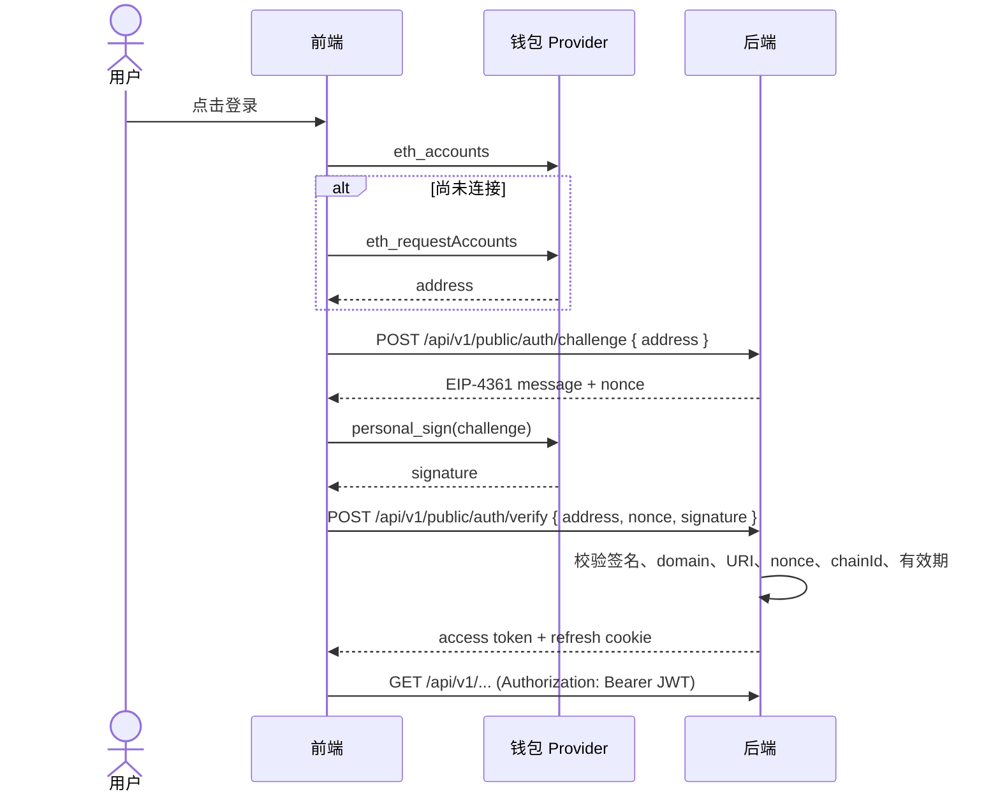
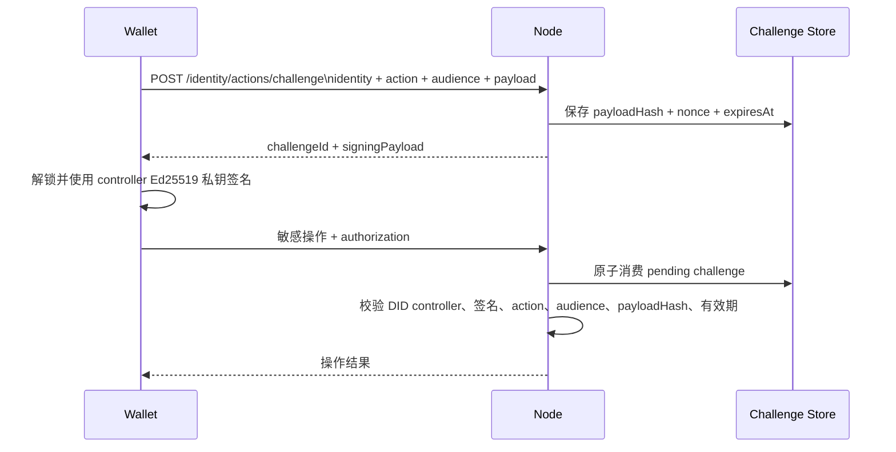

# Node 登录授权

本文说明用户登录 Node 本身时，Node 如何验证用户并建立 Node 会话。这里的 Node 会话用于访问 Node 自身的管理和业务接口，不等同于 DApp 的登录会话，也不代表用户已授权某个 DApp 获取身份资料。

Node 当前有两类面向用户的身份入口：管理端使用 SIWE 验证 EVM 钱包地址并签发 JWT；无钱包插件场景使用邮箱 OTP 登录已注册的钱包身份，建立以 DID 为主体的 Node JWT 会话。邮箱注册会创建钱包兼容身份，并要求客户端完成 Passkey 注册及账户关联。

术语见[核心概念](../architecture/核心概念.md)，认证器及安全边界见[认证器](认证器.md)。DApp 通过 Node 完成应用登录的授权码协议见[DApp登录授权](DApp登录授权.md)。

## 范围与协议边界

- Node 管理端登录：SIWE（EIP-4361）+ JWT。
- 无插件身份登录：邮箱 OTP 验证已有身份 + DID 主体 JWT；注册时还需建立 Passkey 与钱包账户关联。
- `Authorization: Bearer <JWT|UCAN>` 是 Node API 的访问凭证入口，但不同凭证表达的身份和能力不同。
- SIWE 证明用户控制 EVM 地址；邮箱 OTP 只证明用户控制邮箱；Passkey assertion 证明本次操作使用了已登记的认证器凭证。三者证明的事实不可互换。
- Node 登录成功只建立 Node 会话，不会自动授权 DApp。DApp 身份授权见[DApp登录授权](DApp登录授权.md)。

## SIWE (JWT) 流程

对应接口：

- `POST /api/v1/public/auth/challenge`
- `POST /api/v1/public/auth/verify`
- `POST /api/v1/public/auth/refresh`
- `POST /api/v1/public/auth/logout`

固定约束：

- challenge 必须是符合 EIP-4361 的 SIWE Message，不得使用自定义签名文本冒充 SIWE。
- `nonce` 是 challenge 的唯一索引；同一地址允许并发创建多个 challenge，彼此不得覆盖。
- verify 必须提交服务端签发的 `nonce`，challenge 成功使用后立即失效。
- 已连接钱包不得重复发起连接授权；只有 `eth_accounts` 为空时才调用 `eth_requestAccounts`。
- 前端公开方法固定为 `loginWithSiwe()` 和 `logoutSiweSession()`，不得以 UCAN 名称包装 SIWE。

## 业务 API 的访问凭证

Node 业务 API 使用 Bearer 凭证完成资源访问认证。SIWE JWT 表示 Node 会话；UCAN 表示受 audience、资源和动作限制的能力授权。凭证认证成功只是授权判定的第一步，服务端还会检查用户状态、角色、资源归属、路由策略和写请求签名。

### 角色、状态与资源权限

Node 业务权限由有效凭证、用户状态、角色、资源归属及路由策略共同决定。有效 JWT 或 UCAN 本身不代表可以执行任意业务动作。

用户角色包括 `OWNER`、`NORMAL`、`UNKNOWN`；用户状态包括 `ACTIVE`、`OFFLINE`、`DISABLE`、`LOCK`、`AUDIT`、`REFUSED` 等。首次认证或首次访问需要活跃状态校验的业务接口时，Node 会补齐缺失的 `user_state`，默认设为 `NORMAL + ACTIVE`；历史 `UNKNOWN` 账号在再次登录或命中活跃状态校验时升级为 `NORMAL`。

当前主要授权规则包括：

- 应用创建、更新、删除、上架和下架检查资源归属；管理员可按规则覆盖。
- 应用、配置、审核申请及 MPC 写接口要求 `NORMAL` 或 `OWNER`；冻结或禁用用户不能发布或审批。
- 审核动作仅允许审批人执行，并额外要求 `OWNER` 或 vault `ADMIN_DIDS` 治理权限；多审批人按 `audit.approvers` 与 `audit.requiredApprovals` 阈值处理，任一驳回即拒绝。
- `/api/v1/admin/*` 要求 `OWNER` 或 vault `ADMIN_DIDS` 白名单权限。
- 审批列表由服务端过滤和分页；审批详情及列表中的状态摘要由服务端聚合。
- 市场应用、审核、MPC、管理员用户状态、管理员发布和邮件管理等人工敏感写操作还需钱包动作签名。

各业务资源的归属和状态迁移以对应业务文档及当前代码为准。

### 写接口签名协议

受保护的人工写接口要求请求顶层包含 `requestId`、`timestamp` 和 `signature`。签名使用 EVM 地址主体通过 `personal_sign` 生成，消息固定包含 `YeYing Market` 前缀、`Action`、`Actor`、`Timestamp`、`RequestId`，以及 `PayloadHash = sha256(canonical_json(payload))`。

这不是 SIWE 登录消息，也不用于 Wallet Identity controller 操作。身份 Passkey/TOTP 管理使用本文件[钱包身份敏感操作授权](#钱包身份敏感操作授权)中的 Ed25519 一次性动作授权；Pusher、Runtime Agent 等机器调用使用各自的服务密钥签名。

Node 根据实际执行的 payload 重建 hash；请求内容被改写会导致签名失效。服务端持久化消费 `(actor, requestId)`：已完成的相同请求回放首次响应；仍在处理或同一 ID 对应不同 `action/payload` 时返回冲突。请求记录保存在 `action_requests`，后台清理过期完成记录及超时 pending 记录。

默认签名时间窗为 `ACTION_SIGNATURE_MAX_AGE_MS=5 分钟`、`ACTION_SIGNATURE_FUTURE_SKEW_MS=30 秒`。默认清理参数为 `idempotency.successRetentionDays=7`、`failureRetentionDays=1`、`pendingTimeoutMs=15 分钟`、`cleanupIntervalMs=15 分钟`。业务字段 `uid` 和 `createdAt` 不作为签名元数据。

### UCAN 验证、签发与撤销

Node 使用统一的 Bearer 入口验证 JWT 或 UCAN。UCAN 必须匹配目标 audience 和路由要求的 capability，`exp` 必须有效，存在 `nbf` 时需满足时间窗；钱包签发路径还要求完整的 `prf` proof chain。中心化签发的 UCAN 必须来自可信 Node Issuer，并验证签名、`aud/cap/exp/nbf/sub`。Node 自身验证中心化 UCAN 时还要求 `jti` 并检查撤销记录。

钱包模式的链路为 `Root(SIWE) → Delegation → Invocation`；中心化模式信任 Node Issuer。Node 统一处理验证，下游业务路由不因签发来源绕过 audience 或 capability 检查。第三方服务验证 Node 签发的 UCAN 时也必须信任配置中的 Issuer DID，并按标准 UCAN 规则检查签名和授权范围。

中心化 Issuer 提供 `/api/v1/public/auth/central/issuer|session|issue|revoke`：

- `GET /issuer` 返回 Issuer DID、默认 audience/capabilities、模式、就绪状态及公开密钥信息。
- `POST /session` 由已认证的用户会话创建短期签发 session，返回允许的 audiences 和各自 capabilities。历史 SIWE 路径要求 `subject` 与 JWT 地址一致；DApp 路径可从身份授权 exchange 获取受应用策略限制的 `ucanSession`，具体见[DApp登录授权](DApp登录授权.md)。
- `POST /issue` 使用签发 session 获取指定 audience 的 UCAN；audience 必须在 session 允许集合内，capabilities 必须是对应策略的子集。请求可提供 `expiresInMs` 或 `ttlMs`；未提供时服务端按 token TTL、session 剩余 TTL 和服务端上限中的最小值确定有效期。
- `POST /revoke` 撤销当前签发 session。撤销 session 会联动撤销该 session 已签发的 UCAN；token 或 scoped grant 撤销也会写入持久化黑名单。

UCAN 的有效期不得超过签发 session 的剩余有效期和服务端上限；显式申请超过 session 剩余时间会返回 403，session 剩余时间不足一个最小 token TTL 时停止签发。签发记录和审计只保存 token hash、subject、issuer、audience、capabilities、`jti`、session hash 等元数据，不保存明文 bearer token。签发接口应启用限流与异常告警，默认按最小必要能力签发。

#### Issuer 配置与密钥轮换

中心化 Issuer 由 `issuer.ucan.enabled` / `UCAN_ISSUER_ENABLED` 和 `issuer.ucan.mode` / `UCAN_ISSUER_MODE` 控制；模式取值为 `verify`（仅验证，默认）、`issue`（启用中心化签发及验证）和 `hybrid`（钱包 UCAN 验证与中心化签发并用）。`issuer.baseUrl` 用于派生统一 Node Issuer DID。

签发配置包括 `ISSUER_PRIVATE_KEY`、`issuer.ucan.sessionTtlMs` / `UCAN_ISSUER_SESSION_TTL_MS`、`issuer.ucan.tokenTtlMs` / `UCAN_ISSUER_TOKEN_TTL_MS`、`issuer.ucan.defaultAudience` / `UCAN_ISSUER_DEFAULT_AUDIENCE`、`issuer.ucan.defaultCapabilities` / `UCAN_ISSUER_DEFAULT_CAPABILITIES`、`issuer.ucan.allowedAudiences` 和 `issuer.ucan.allowedCapabilitiesByAudience`。`ISSUER_PRIVATE_KEY_NEXT` 和 `ISSUER_PRIVATE_KEY_PREVIOUS` 仅用于轮换窗口；密钥从加密密钥文件或安全密钥管理服务加载，不得写入仓库或普通配置。`scripts/verify-secrets.cjs` 只要求 active key。

显式设置允许 audience 时，必须为每个 audience 配置 capability；配置不完整应保持 `ready=false`，不能退回宽松默认权限。应用登记的 `ucanAudience/ucanCapabilities` 必须是 Issuer 全局策略子集。所有 Node 实例应使用相同的 issuer URL、策略、密钥环及共享的持久化撤销状态。

密钥轮换顺序：

1. 将新的 Ed25519 seed 配置为 `ISSUER_PRIVATE_KEY_NEXT`，部署后确认 issuer endpoint 同时发布 active 与 next 的 `kid`。
2. 将旧 active 配置为 `ISSUER_PRIVATE_KEY_PREVIOUS`，提升 next 为 active，并滚动重启全部实例。
3. 确认新 active 用于签发，旧 active 仍在 JWKS 和本地 verifier 的信任窗口中。
4. 等待旧 token 最大有效期、时钟偏差及下游 JWKS 缓存刷新时间全部经过后，再移除 previous。
5. 下轮轮换前清理过期 next，避免同一公钥被识别为多个角色。

Next 只用于提前发布公钥，不用于当前签发。不能仅依据实例重启时间删除 previous。

#### 排障与观测

日志可记录 `authMode`（`wallet_ucan`、`central_ucan` 或 `jwt`）、`issuerDid`、`subject`、`aud`、`cap`、`sessionId/requestId`、`tokenId/jti` 和 `sessionHash`（仅 SHA-256）。观测中心化签发成功率、session 创建成功率，以及 audience 不匹配、capability 拒绝、过期和签名失败等验证结果；不得记录 session 或 UCAN 明文。

### 无钱包插件的邮箱入口

Node 前端首页提供邮箱登录/注册入口，相关接口为：

- `POST /api/v1/public/auth/email/register/request`
- `POST /api/v1/public/auth/email/register/resend`
- `POST /api/v1/public/auth/email/register/cancel`
- `POST /api/v1/public/auth/email/register/confirm`
- `POST /api/v1/public/auth/email/register/complete`
- `POST /api/v1/public/auth/email/login/request`
- `POST /api/v1/public/auth/email/login/confirm`

注册时浏览器先生成与 Wallet 相同格式的 `did:yeying:wid_*` DID Document、Ethereum 主网账户和密码加密材料。发送验证码前，页面必须确认当前是安全上下文且 WebAuthn 可用，并调用平台认证器能力检测：检测到平台认证器时默认使用本机设备（Windows PIN、屏幕锁、指纹或人脸）；未检测到时，用户必须先选择手机跨设备认证或外接安全密钥。Google Play、Google 密码管理工具和 iCloud 不是协议前置条件，但浏览器必须实际具备一种可完成 WebAuthn 的认证器。

`/email/register/request` 只固定 pending registration、DID Document hash、邮箱验证码和用户名预约，不提前创建 WebAuthn challenge。`/email/register/confirm` 在 OTP 验证成功后接收 `authenticatorMode=platform|hybrid|security-key`，按模式生成 `residentKey=required`、`userVerification=required` 的 discoverable credential challenge。若用户取消系统提示，可保留同一验证码与本地加密草稿、切换认证方式并再次确认；Node 在同一 challenge 记录上轮换 challenge 值并立即废止旧值，同时保持 registration ID、DID、钱包地址、DID Document hash 和用户名预约不变。

邮箱验证码确认后仍必须完成浏览器 Passkey 注册，并使用生成账户完成 EIP-191 账户关联；浏览器将 Wallet v2 兼容的外层密文随注册完成请求提交。Node 只保存 DID、用户名、头像、邮箱凭证、Passkey 公钥、账户关联和密文，不接收密码或任何明文私钥，之后才签发以 DID 为主体的 JWT。登录只需邮箱验证码，JWT 仍只代表 Node 会话。邮箱 OTP 不能激活钱包控制权、不能替代 Passkey、不能直接取得 `custody.recovery`；完全不支持 WebAuthn 的设备不提供 OTP-only 降级。

验证码请求后，浏览器会把继续注册所需的客户端材料以账户密码经 PBKDF2-SHA256 与 AES-GCM 加密后短期保存在 IndexedDB。刷新或返回首页时，用户重新输入账户密码即可恢复原注册身份和验证码步骤；密码、OTP 与访问令牌不会写入浏览器持久化存储。该草稿只适用于当前浏览器配置文件，注册成功、取消或草稿过期后会清除。验证码重发至少间隔一分钟，最多重发五次，并复用原 registration 与用户名预约；成功发送新验证码后，旧验证码立即失效。用户可显式取消并重新开始注册。若浏览器站点数据被清理或草稿损坏，原本地私钥无法恢复，只能取消仍可识别的旧请求或等待其过期后重新注册。

邮箱 OTP 不是私钥恢复密钥。密码丢失时 Node 上的密文不可恢复；跨设备恢复同一 Wallet 身份由 Wallet 插件使用用户密码解密 custody v2 密文，恢复同一 DID、controller/recovery 密钥和 Ethereum 地址。Node 不根据邮箱验证码生成或解密身份私钥。

## 钱包身份敏感操作授权

登录态和 DID Document 均不能代表用户批准了当前敏感操作。注册或撤销 Passkey、创建或替换 TOTP、撤销 TOTP 必须使用一次性 Wallet Identity 动作授权。

签名对象固定包含：

- `version = 1`
- `purpose = wallet-identity-action-authorization`
- `challengeId`
- `identity`
- `action`
- `audience`
- `payloadHash`
- `nonce`
- `issuedAt`
- `expiresAt`

Node 使用 RFC 8785 兼容的确定性 JSON 排序后验证 Ed25519 签名。challenge 只能成功消费一次；DID Document 的长期签名只用于定位和验证 controller 公钥。

受保护动作：

| action | 操作 |
| --- | --- |
| `identity.passkey.register` | 注册 Passkey |
| `identity.passkey.revoke` | 撤销 Passkey |
| `identity.totp.setup` | 创建或替换 TOTP |
| `identity.totp.revoke` | 撤销 TOTP |

## 接口与维护边界

SIWE、邮箱注册登录和 Node 身份敏感操作的完整请求/响应字段以 [OpenAPI Identity](../openapi/node.openapi.yaml) 为准。邮箱绑定唯一性、验证事务、错误码和 VC 续签规则见[身份凭证](身份凭证.md)。

Node 登录、UCAN 验证/签发/撤销、用户角色或状态权限、写请求签名和 Issuer 密钥轮换规则变更时，应同步更新本文档及对应 OpenAPI。运行配置仍以根目录 `config.js.template` 和生产部署手册为准。
