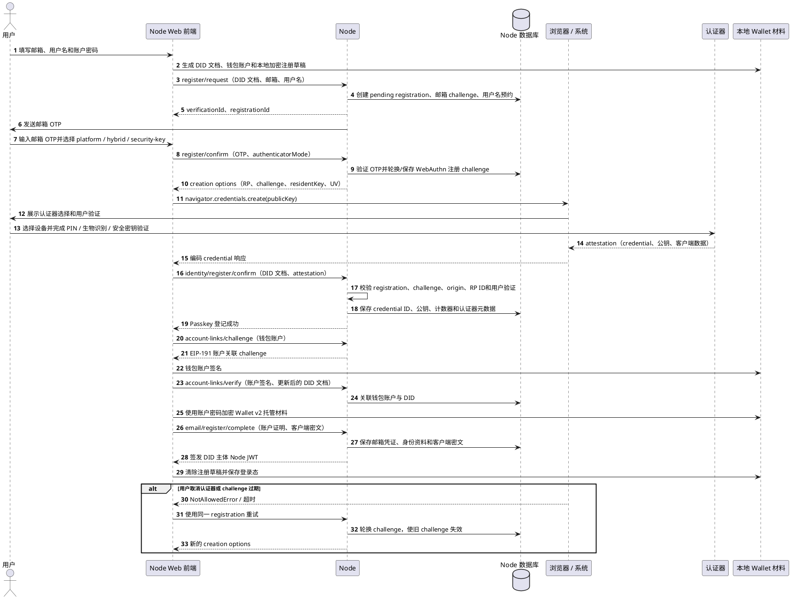
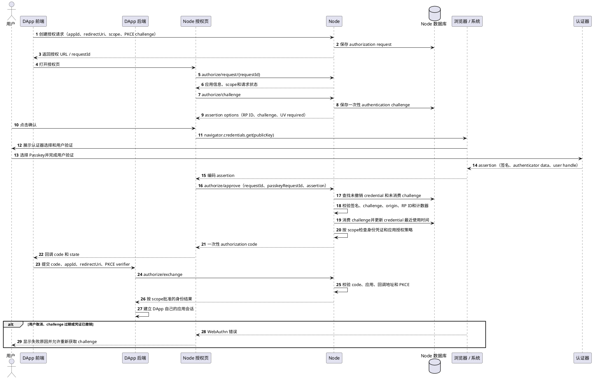

# 通行密钥

本文说明 Node 与 YeYing Wallet 当前如何创建、登记和使用认证器，并分析浏览器、Windows、macOS 与外接设备之间的兼容边界。**Web 身份验证（Web Authentication，简称 WebAuthn）**是浏览器调用认证器创建或使用公钥凭证的标准 API 与协议。本文统一称 Passkey 为“通行密钥”：它是认证器创建或持有的 WebAuthn 凭证；“认证器”指能够执行 WebAuthn 操作的设备或软件。邮箱 OTP 是另一种验证因素，不是 WebAuthn 认证器。

接口字段和状态码以 [Node登录授权](Node登录授权.md)、[DApp登录授权](DApp登录授权.md)及 [OpenAPI](../openapi/node.openapi.yaml) 为准。钱包密钥托管与恢复见[钱包托管](../business/钱包托管.md)。

## 先区分三种东西

| 名称 | 在当前系统中的作用 | 不能据此推断 |
| --- | --- | --- |
| 认证器（Authenticator） | 操作系统、浏览器可调用的凭证管理器、手机或安全密钥；为 WebAuthn 创建密钥对并在认证时签名 | 它不必是独立硬件，也不等于 Node 账户或 DID |
| 通行密钥（Passkey） | 认证器为特定 RP 创建的 WebAuthn 凭证；Node 以 credential ID、公钥、RP ID 和状态登记它 | 它不是钱包私钥、DID controller 私钥、VC 或链上签名 |
| 邮箱 OTP | 通过邮件验证码证明当前能访问某邮箱；Node 用它完成邮箱登录或邮箱注册前置验证 | 邮箱 OTP 不是认证器，也不能代替 Passkey assertion 或钱包账户签名 |

浏览器显示的 Google 密码管理工具、iCloud 钥匙串、Chrome 个人资料、手机或安全密钥等选项，是系统/浏览器提供的凭证创建位置或认证器路径。Node 发起 WebAuthn 请求并校验结果，但不能选择或控制这些供应商的账户、同步和设备策略。

## 参与方与密钥归属

| 参与方/数据 | 职责与可见内容 |
| --- | --- |
| 用户及客户端 | 选择认证方式、查看浏览器或系统提示并完成用户验证。无插件邮箱注册时，浏览器还生成 DID 文档和钱包材料，并在本地创建受密码保护的注册草稿。 |
| 浏览器 / WebAuthn 客户端 | 检查安全上下文，将 Node 的 challenge、RP 参数和选择提示交给操作系统或认证器；把认证器返回的 attestation/assertion 编码后发回 Node。浏览器通常不向网页暴露凭证私钥。 |
| 认证器 | 创建并持有 WebAuthn 凭证私钥；创建时生成注册响应，认证时对 challenge、RP 与客户端数据签名。 |
| Node（Relying Party，RP） | 生成并保存一次性 challenge，验证 challenge、origin、RP ID、用户验证、凭证公钥与状态；保存 credential ID、公钥、计数器、transports、设备名和状态。Node 不保存 Passkey 私钥。 |
| Wallet 插件 | 管理 Wallet Identity DID 和已登记的认证器；可通过 DID controller 签名完成身份出示或敏感操作授权。插件的 EVM 钱包登录（SIWE）与 Passkey 认证是不同路径。 |

身份主体仍是 Wallet Identity DID。Passkey 记录会关联到 DID，但凭证本身不取代 DID controller，也不会把邮箱、钱包地址或凭证管理器账户变成身份主体。术语见[核心概念](../architecture/核心概念.md)。

## 完整生命周期

### 1. 发现运行环境能力

无插件邮箱注册页面先检查：页面是否处于安全上下文（生产通常为 HTTPS；可信的 localhost 例外）、`PublicKeyCredential` 与 `navigator.credentials` 是否存在，以及浏览器能否报告平台认证器可用。

平台认证器能力检测只是能力提示，不能可靠地枚举电脑里所有可用认证器，也不能证明跨设备或安全密钥路径一定可用。若平台检测不可用或返回 false，当前页面要求用户明确选择“手机/跨设备”或“外接安全密钥”；它不会将此结果解释为设备完全不支持 WebAuthn。最终能否成功，以系统提示及实际 `navigator.credentials.create()` 结果为准。

注册流程提供三种偏好：

| 注册偏好 | 当前发给 WebAuthn 的选择 | 预期使用方式 |
| --- | --- | --- |
| 本机设备（`platform`） | `authenticatorAttachment=platform`，并偏好本机设备 | Windows Hello、Touch ID 等平台认证器；须由设备、系统、浏览器版本和策略共同支持 |
| 手机/跨设备（`hybrid`） | `authenticatorAttachment=cross-platform`，偏好远端设备；客户端将 `hybrid` 作为 WebAuthn hint | 由浏览器/系统提供手机等远端认证器流程。是否显示二维码及其交互由平台决定 |
| 外接安全密钥（`security-key`） | `authenticatorAttachment=cross-platform`，偏好安全密钥；客户端传递相应 hint | 由 USB、NFC 或蓝牙安全密钥完成。连接方式、用户验证能力和浏览器支持各异 |

这里的 `hybrid` 是 WebAuthn 传输/提示路径，不是 YeYing 自创的认证协议；hint 是偏好，浏览器可能忽略或不支持。认证器选择弹窗由浏览器和操作系统展示，Node 无法强制指定 Google Password Manager、iCloud Keychain 或某个本地实现。

### 2. 创建并登记通行密钥（Passkey）

无插件邮箱注册的当前顺序如下。图中的“浏览器/系统”包含浏览器、操作系统凭证管理器和用户选定的认证器。

图中“认证器”是浏览器通过 WebAuthn 调用的凭证提供方：可以是 Windows Hello、macOS Touch ID 或系统凭证管理器、手机上的凭证管理器，也可以是 USB/NFC 安全密钥。跨设备方式下，认证器也可能位于用户选择的手机上。浏览器负责转交 WebAuthn 请求和响应；认证器创建并管理通行密钥私钥，Node 只登记凭证 ID、公钥及相关状态。认证器中的通行密钥私钥，与下方本地 Wallet 材料中的钱包私钥、DID controller/recovery 私钥相互独立。

图中“本地 Wallet 材料”是网页客户端管理的数据，不是一个单独的服务或已安装的 Wallet 插件。邮箱注册期间，浏览器客户端生成 DID Document、身份 controller/recovery 密钥、以太坊钱包账户及其私钥，并在内存中使用这些材料完成注册、签名和加密。为支持页面刷新后继续注册，客户端会把注册草稿用账户密码加密后存入当前浏览器的 IndexedDB；草稿包含恢复注册所需的密钥材料，但不保存账户密码。注册完成或取消后，草稿会被清除。提交给 Node 的托管内容是客户端加密后的密文，Node 不接收这些私钥的明文。

这条流程中，邮箱 OTP 只完成邮箱验证，Passkey 只完成认证器登记，账户关联和客户端加密托管还必须分别成功。Node 不接收用户设置的密码或明文私钥。

Passkey 创建成功只完成认证器登记，不单独完成账户关联、托管或注册。任一步失败都可能留下待完成的注册草稿；恢复、重试与过期处理见[Node登录授权](Node登录授权.md)。

已有 Wallet 身份添加 Passkey 时，用户可以在 Wallet 的“设置 → 钱包身份 → 通行密钥”页面发起管理操作。这里的添加不是脱离身份的独立注册：用户必须先选中已有 Wallet Identity，输入钱包密码，由插件使用 DID controller 对 `identity.passkey.register` 敏感操作签名；Node 发放注册 challenge，插件/浏览器再调用认证器创建凭证并提交验证。Node 把新凭证关联到原 DID。查看和撤销也从钱包插件发起；撤销需要新的敏感操作授权。钱包身份管理的权威步骤仍以 Wallet 客户端实现及 Node API 为准。

### 两条登记路径的关系

这两条流程最终都把 WebAuthn Passkey 作为认证器登记到同一个 Node 身份服务，并将凭证绑定到一个 Wallet Identity DID。Node 保存的是 credential ID、公钥、RP ID、计数器和状态；认证器私钥仍由浏览器/操作系统/外接设备侧持有。

差异在于身份和授权的起点：

| 对比项 | 有 Wallet 插件 | 无插件邮箱注册 |
| --- | --- | --- |
| DID 和控制密钥的创建方 | Wallet 插件在本地创建并管理 Wallet Identity DID、controller/recovery 密钥 | Node Web 页面在浏览器本地创建与 Wallet 兼容的 DID 和身份材料 |
| Passkey 是否是创建身份的必需步骤 | 不是。身份可以先存在，Passkey 可以之后添加 | 是。邮箱 OTP 验证后必须完成 Passkey 登记，才能激活这次注册 |
| 登记 Passkey 前的授权 | 已有 DID controller 对 `identity.passkey.register` 敏感操作签名 | 先验证邮箱 OTP，再使用 bootstrap registration challenge；邮箱 OTP 只证明邮箱控制权 |
| 登记后的收尾步骤 | Wallet 继续完成链账户关联、资料验证或其他身份管理流程 | 还必须完成钱包账户 EIP-191 签名关联，并提交账户密码加密的托管密文 |
| 后续无插件登录 | 只有该 DID 已登记可用 Passkey 后，DApp 才能用 Passkey 授权登录 | Passkey 是注册完成条件，注册成功后即可作为无插件 DApp 授权的认证器 |

所以，“都有创建 Passkey 并登记”描述的是 Node 侧的凭证登记动作相同；它不表示两边创建了两个不同的身份，也不表示邮箱本身是认证器。钱包插件路径是“已有 DID 添加认证器”，邮箱路径是“创建兼容 DID 的同时强制建立第一个认证器”。两条路径最终可以收敛到同一 DID、同一组身份凭证和同一套 Node Passkey 记录模型。

### 3. 使用通行密钥（Passkey）完成 DApp 身份授权

当前 Node 授权页的 Passkey 流程如下：

当前浏览器选项请求 `userVerification=required`，但服务端调用 `verifyAuthenticationResponse` 时没有显式设置 `requireUserVerification: true`，因此不能仅凭 options 断言服务端一定拒绝未设置 UV 标志的 assertion；这需要单独补强并测试。

Passkey assertion 证明该次请求由登记的认证器完成用户验证；它本身不包含邮箱证明、钱包账户签名，也不直接授予 DApp 任意资源能力。详细流程见[DApp登录授权](DApp登录授权.md)。

### 4. 当前邮箱登录与其他认证器使用点

需要区分“邮箱注册时必须登记 Passkey”和“邮箱登录时使用 Passkey”：当前 Node 邮箱登录端点验证邮箱 OTP，并签发 DID 主体的 Node JWT；这个登录步骤本身不调用 WebAuthn assertion。Passkey 另用于 DApp 授权页，以及身份级 Passkey/TOTP 管理、托管等按具体策略要求的操作。

装有 Wallet 插件的用户可使用钱包身份 Presentation，由 DID controller 对绑定 audience、nonce 等上下文签名；Node 或应用验证这个签名。Wallet 站点的 SIWE 登录则证明对 EVM 地址的控制。SIWE、DID Presentation、Passkey assertion 和邮箱 OTP 是不同证明，不能互相替换。

## Windows 与旧版 macOS 的兼容判断

目前无法仅凭“Windows”或“老 Mac”判定认证器一定不可用。WebAuthn 成功取决于浏览器版本与策略、操作系统版本、设备硬件/系统认证器状态、浏览器是否能访问凭证提供方、Node 配置的 RP ID/origin，以及用户实际选择的路径。旧版 macOS 可能缺少系统 Passkey/平台认证器能力；Windows 机器可能未配置 Windows Hello，或浏览器环境不允许使用它。这些情况仍可能与支持的手机跨设备认证或外接安全密钥不同，需逐台验证。

排障时按实际失败阶段定位：

| 现象/阶段 | 优先检查 | 当前可见的边界 |
| --- | --- | --- |
| 注册页提示不支持或按钮不可用 | HTTPS/localhost、安全上下文、浏览器是否有 `PublicKeyCredential` 和 `navigator.credentials` | 完全没有 WebAuthn API 或非安全上下文时，当前无插件注册无法继续；OTP 不会临时降级为身份认证 |
| 平台选项被禁用 | `isUserVerifyingPlatformAuthenticatorAvailable()` 的返回值、系统认证器是否配置、浏览器版本和设备策略 | 检测结果 false 只表示当前 API 没报告可用平台认证器；跨设备/安全密钥仍需用户实际选择并测试 |
| 系统弹窗没有合适选项或立即失败 | 选择的 mode、浏览器/系统提供方、Windows Hello/Touch ID 设置、外接设备连接状态和用户验证能力 | Web 页面无法强制改变浏览器的凭证管理器选择界面 |
| 用户选择后取消或超时 | 浏览器错误名、USB/NFC/Bluetooth 权限/连接、手机与电脑的蓝牙/网络/锁屏状态、challenge 是否仍有效 | 注册 challenge 默认短期有效；当前验证码确认后会按所选方式生成/轮换 challenge，过期需要重新获取 |
| 凭证创建成功但 Node 拒绝 | response 的 `clientDataJSON.origin`、RP ID 与域名关系、Node 的 `identity.webauthn.rpId/origin`、challenge/registration 时效、系统时钟 | Node 严格验证 origin/RP/challenge；配置不一致时只反复换认证器也不会解决 |
| 注册完成但不能登录 DApp | 凭证是否成功入库、是否已撤销、浏览器是否能访问同一 RP 下的凭证、授权页实际 origin、请求 scope 所需 VC | 邮箱 OTP 登录成功不代表 DApp Passkey 授权已成功；两条流程分别验证 |

### 为什么目前仍可能“半可用”

代码已提供平台、手机/跨设备和外接安全密钥三种注册选择，并对用户取消保留注册草稿、允许切换方式重试。但现有测试主要验证服务端 challenge 生命周期、origin 校验、凭证保存/撤销和业务流程；这些测试通过 mock WebAuthn 响应完成，不等于真实 Windows、旧版 macOS、不同浏览器、手机 Hybrid 或硬件密钥的端到端兼容已经验证。

另外，平台认证器检测是能力提示，不是完整的 WebAuthn 兼容性探测；服务端下发的 `authenticatorAttachment` 和 `preferredAuthenticatorType` 约束/偏好，也不能保证操作系统弹窗一定能提供用户期待的保存位置。用户取消、系统 PIN/Touch ID 未启用、浏览器策略、RP/origin 配置差异、凭证同步状态及旧浏览器对 WebAuthn 选项的支持，都可能造成不同的失败表现。因此现在可以说明“应用有这些路径”，但不能据此承诺“所有 Windows/旧 Mac 均可用”。

要把兼容性问题收敛成可修复事项，建议为每个失败样本记录：操作系统及版本、设备型号、浏览器及版本、页面 origin、Node RP ID/origin、选择的认证方式、系统弹窗中选择项、用户完成/取消结果、浏览器异常名、Node 错误码和失败阶段；不要记录验证码、私钥、原始凭证私密材料。再按下表建立真实设备验收：

| 平台 | 本机认证器 | 手机跨设备 | 外接安全密钥 | 注册后新会话认证 |
| --- | --- | --- | --- | --- |
| 当前受支持 Windows + Chrome/Edge | 待真实设备验收 | 待真实设备验收 | 待真实设备验收 | 三种方式分别验证 |
| 旧版 macOS + 实际使用浏览器 | 待按系统/硬件验证 | 待真实设备验收 | 待真实设备验收 | 注册成功的方式须重新执行 assertion |
| 不支持 WebAuthn 的浏览器/环境 | 不支持 | 不支持 | 不支持 | 无插件邮箱身份注册应明确阻止并说明原因 |

这些验收能区分浏览器兼容、系统认证器配置、跨设备链路、Node RP 配置和页面错误处理，避免把所有问题笼统归结为“Passkey 不支持”。

## 安全属性与限制

- Node 校验 challenge、origin、RP ID、公钥签名和登记状态；请求会要求认证器进行用户验证，但当前 assertion 服务端校验未显式要求 UV 标志，须按上文补强后才能把“服务端确认用户验证完成”作为安全保证。
- WebAuthn origin/RP 绑定可降低钓鱼和跨站重放风险；一次性短时 challenge 防止旧 assertion 重放。
- 平台凭证可能由 Apple、Google、Microsoft 等平台同步。同步便利性和平台账户安全由相应提供方管理；Node 看不到其私钥或同步状态。
- Passkey 不是钱包恢复密钥。托管密文读取授权与钱包本地解密仍有各自门槛；单独的邮箱 OTP 或 Passkey assertion 不会解密钱包数据。
- 邮箱 OTP 登录是当前独立的 Node 会话入口。邮箱账户安全、邮件转发或邮箱被接管会影响 OTP 路径；不能把 OTP 登录 JWT 当作 DID controller 签名或钱包控制证明。
- 撤销某条 Passkey 后，该凭证不得再通过 Node 验证；若撤销的是最后一条可用凭证，用户应先登记并验证另一个可用认证器，避免失去 DApp 授权或托管相关操作能力。

## 阅读路径

- Node 本身的钱包/邮箱登录和 Passkey 注册前置条件：[Node登录授权](Node登录授权.md)。
- DApp 使用 Wallet Presentation 或 Passkey 完成登录授权：[DApp登录授权](DApp登录授权.md)。
- DID、认证器、Passkey、Hybrid、VC 等术语：[核心概念](../architecture/核心概念.md)。
- VC 类型、签发、续签和撤销：[身份凭证](身份凭证.md)。
- 客户端密文托管和恢复流程：[钱包托管](../business/钱包托管.md)。
- 请求字段、端点和错误语义：[OpenAPI Identity](../openapi/node.openapi.yaml)。
